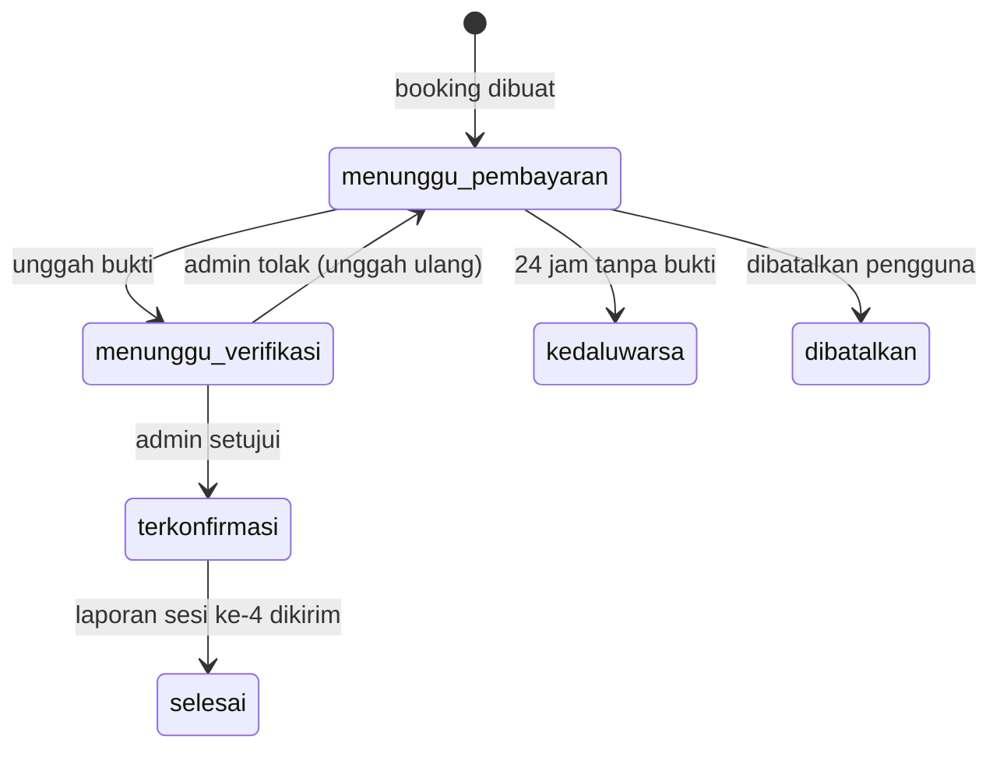

# PRD — Website Bimbel Teknologi Daring SD, SMP, SMA (SEVENT X)

Versi 22 November 2026 · Tim: Khalil Amin Adillah, Mgs. M. Fahim Rahmatullah, Raihan Daris Ramadhan

> Sumber kebenaran tunggal untuk frontend dan backend. Setiap perubahan kontrak (bagian 7–9) wajib dicatat di `docs/KEPUTUSAN.md`.

## 1. Ringkasan produk

Website bimbel teknologi daring untuk siswa SD, SMP, dan SMA dengan harga terjangkau. Pengajarnya mahasiswa dan pencari kerja paruh waktu yang dibayar per sesi dan mengajar memakai Teaching Playbook terstandar. Produk ini diikutkan ke lomba Software Development SEVENT X kategori website, subtema SDG 4 (Quality Education) dan SDG 8 (Decent Work and Economic Growth).

**Tiga program**

| Program | Jenjang | Isi | Hasil akhir |
| --- | --- | --- | --- |
| Coding Dasar | SD kelas V–VI | Logika, berpikir komputasional, pemrograman blok | Proyek kecil per sesi |
| Kelas Reguler Teknologi | SMP dan SMA | Pemrograman, web, IoT virtual, AI dasar, berjenjang per level | Proyek per bulan |
| Simulasi Jurusan IT | SMA kelas 10–12 dan SMP kelas 9 | 4 sesi: software engineering, jaringan komputer, IoT, integrasi AI | Rapor rekomendasi jurusan kuliah |

**Tujuan produk**

1. Memperluas akses belajar teknologi bagi siswa SD sampai SMA.
2. Membantu siswa SMA memilih jurusan IT lewat pengalaman mencoba langsung.
3. Membuka peluang penghasilan tambahan yang fleksibel bagi mahasiswa dan pencari kerja.
4. Menjaga mutu dan keamanan lewat playbook, verifikasi pengajar, dan laporan setiap sesi.

**Metrik keberhasilan MVP (untuk demo lomba)**

| Metrik | Target |
| --- | --- |
| Alur inti berjalan tanpa error di website yang ter-deploy | Tes minat → booking → bayar → verifikasi → kelas → laporan → rating |
| Laporan pengajar muncul di dashboard siswa dan orang tua tanpa refresh | Di bawah 3 detik setelah dikirim |
| Tampilan responsif | Layak dipakai di lebar 360 px (ponsel) sampai 1440 px (desktop) |
| Skor Lighthouse halaman publik | Performance dan Accessibility minimal 90 |
| Karya dikumpulkan | Paling lambat 28 November 2026 |

## 2. Ruang lingkup MVP

| Masuk MVP | Tidak masuk MVP (ditulis sebagai rencana pengembangan di proposal) |
| --- | --- |
| Beranda publik, halaman program, profil pengajar terverifikasi | Payment gateway otomatis |
| Registrasi dan login empat peran: orang tua, siswa, pengajar, admin | Video call bawaan (kelas memakai Google Meet yang dibuat otomatis per sesi) |
| Persetujuan orang tua lewat link untuk siswa yang mendaftar sendiri | Gamifikasi (XP, lencana, leaderboard) |
| Tes minat jurusan IT dengan hasil rekomendasi | Notifikasi WhatsApp |
| Booking sesi untuk tiga program | Portofolio publik siswa |
| Pembayaran manual: transfer atau QRIS + unggah bukti, diverifikasi admin | Aplikasi mobile |
| Verifikasi pengajar oleh admin | Chat antara pengguna |
| Teaching Playbook per sesi, dan link Google Meet yang dibuat otomatis untuk setiap sesi | Penarikan dana pengajar otomatis |
| Laporan setelah kelas, tampil realtime | Multi-bahasa |
| Rapor rekomendasi jurusan di sesi terakhir Simulasi Jurusan IT |  |
| Rating sesi |  |
| Riwayat sesi dan penghasilan pengajar |  |
| Dashboard admin: verifikasi pengajar, verifikasi pembayaran, laporan masalah |  |

Semua data di versi lomba adalah data contoh (seed). Alur pembayaran dibuat lengkap, tetapi saat demo bukti bayar cukup berupa gambar contoh dan tidak ada uang yang benar-benar diproses.

## 3. Peran pengguna dan hak akses

| Peran | Siapa | Cara mendapat akun |
| --- | --- | --- |
| Tamu | Pengunjung yang belum login | Tidak perlu akun |
| Orang tua | Orang tua atau wali siswa | Daftar sendiri, atau dibuat saat menyetujui link persetujuan dari anak |
| Siswa | Siswa SMP dan SMA yang mendaftar sendiri | Daftar sendiri, akun berstatus `menunggu_persetujuan` sampai orang tua menyetujui |
| Pengajar | Mahasiswa atau pencari kerja | Daftar sendiri, akun berstatus `menunggu_verifikasi` sampai disetujui admin |
| Admin | Tim inti | Dibuat lewat seed atau langsung di database, tidak ada registrasi publik |

**Profil anak.** Siswa SD tidak punya akun login. Orang tua membuat profil anak di dashboard-nya. Orang tua juga boleh membuat profil anak untuk siswa SMP atau SMA. Siswa yang mendaftar sendiri otomatis terhubung ke akun orang tua setelah persetujuan.

**Matriks hak akses** (✓ = boleh, — = tidak boleh)

| Aksi | Tamu | Orang tua | Siswa | Pengajar | Admin |
| --- | --- | --- | --- | --- | --- |
| Melihat beranda, program, profil pengajar terverifikasi | ✓ | ✓ | ✓ | ✓ | ✓ |
| Mengerjakan tes minat | ✓ (hasil tidak tersimpan) | ✓ untuk anaknya | ✓ | — | — |
| Membuat dan mengelola profil anak | — | ✓ | — | — | — |
| Membuat booking | — | ✓ untuk anaknya | ✓ untuk dirinya, setelah disetujui orang tua | — | — |
| Mengunggah bukti bayar | — | ✓ | ✓ | — | — |
| Memverifikasi pembayaran | — | — | — | — | ✓ |
| Membuka Teaching Playbook | — | — | — | ✓ untuk sesi miliknya | ✓ |
| Membuka kelas | — | — | — | ✓ | — |
| Mengisi laporan dan rapor | — | — | — | ✓ untuk sesi miliknya | — |
| Melihat laporan dan rapor | — | ✓ milik anaknya | ✓ miliknya | ✓ yang ia tulis | ✓ semua |
| Memberi rating sesi | — | ✓ | ✓ | — | — |
| Melaporkan masalah pada sesi atau pengajar | — | ✓ | ✓ | — | — |
| Memverifikasi dan menonaktifkan pengajar | — | — | — | — | ✓ |
| Melihat penghasilan | — | — | — | ✓ miliknya | ✓ semua |
| Mengelola program dan playbook | — | — | — | — | ✓ |

Semua aturan di tabel ini wajib ditegakkan di backend, bukan hanya disembunyikan di frontend.

## 4. Spesifikasi fitur

Setiap fitur punya kode (F1, F2, …) supaya mudah dirujuk di issue GitHub dan commit.

### F1. Registrasi dan login

**User story:** Sebagai orang tua, siswa, atau pengajar, saya ingin membuat akun supaya bisa memakai layanan sesuai peran saya.

- Login memakai email dan password. Password minimal 8 karakter.
- Saat daftar, pengguna memilih peran: orang tua, siswa, atau pengajar. Admin tidak bisa dipilih.
- Field siswa: nama lengkap, tanggal lahir, jenjang (SMP atau SMA), kelas, nama sekolah (opsional), nama orang tua, email orang tua (opsional).
- Field orang tua: nama lengkap, nomor WhatsApp.
- Field pengajar: lihat F7.

**Kriteria penerimaan**

- [ ] Email yang sudah terdaftar ditolak dengan pesan “Email sudah dipakai”.
- [ ] Jika siswa memilih jenjang SD, form berhenti dan menampilkan pesan bahwa siswa SD didaftarkan oleh orang tua, beserta tombol ke pendaftaran orang tua.
- [ ] Setelah daftar, siswa masuk dengan status `menunggu_persetujuan` dan diarahkan ke halaman persetujuan orang tua (F2).
- [ ] Pengajar masuk dengan status `menunggu_verifikasi` dan hanya bisa melihat dashboard status verifikasinya.
- [ ] Logout menghapus sesi di perangkat tersebut.
- [ ] Lupa password: di luar MVP. Admin bisa mereset lewat database saat demo.

### F2. Persetujuan orang tua

**User story:** Sebagai siswa SMP atau SMA, saya ingin mendaftar sendiri lalu meminta persetujuan orang tua. Sebagai orang tua, saya ingin tahu data apa yang dipakai sebelum menyetujui.

- Sistem membuat token persetujuan sekali pakai yang berlaku 7 hari.
- Halaman siswa menampilkan link persetujuan, tombol **Salin link**, dan tombol **Kirim via WhatsApp** (link `wa.me` dengan teks siap kirim).
- Halaman persetujuan (`/persetujuan/{token}`) menampilkan: nama siswa, data yang dikumpulkan, tujuan pemakaian data, dan aturan keamanan kelas.
- Orang tua mencentang persetujuan, lalu login atau membuat akun orang tua di halaman yang sama. Setelah itu, akun siswa terhubung ke akun orang tua.
- Orang tua juga bisa menekan **Tolak**.

**Kriteria penerimaan**

- [ ] Setelah disetujui, status siswa berubah menjadi `aktif`, dan siswa bisa booking.
- [ ] Setelah ditolak, status siswa menjadi `ditolak_orang_tua`, dan siswa tidak bisa booking.
- [ ] Token yang kedaluwarsa atau sudah dipakai menampilkan pesan “Link tidak berlaku”. Siswa bisa membuat link baru, dan link lama otomatis tidak berlaku.
- [ ] Sebelum disetujui, siswa tetap bisa melihat program dan mengerjakan tes minat.
- [ ] Waktu persetujuan dan akun orang tua yang menyetujui tersimpan di database sebagai bukti.

### F3. Profil anak

**User story:** Sebagai orang tua, saya ingin mendaftarkan satu atau beberapa anak tanpa mereka perlu punya akun.

- Field: nama lengkap, tanggal lahir, jenjang (SD, SMP, SMA), kelas, nama sekolah (opsional).
- Orang tua bisa menambah, mengubah, dan menghapus profil anak yang belum punya booking aktif.

**Kriteria penerimaan**

- [ ] Program yang tampil saat booking otomatis disaring sesuai jenjang dan kelas anak.
- [ ] Profil anak yang punya booking aktif tidak bisa dihapus. Muncul pesan penjelasan.
- [ ] Akun siswa yang terhubung lewat F2 tampil di daftar anak dengan label “punya akun sendiri”.

### F4. Tes minat jurusan IT

**User story:** Sebagai siswa atau orang tua, saya ingin tahu bidang IT dan program yang paling cocok sebelum mendaftar.

- Berisi 12 soal pilihan ganda, masing-masing dengan 4 opsi. Setiap opsi memberi poin ke satu atau lebih dari 4 bidang: **Software**, **Jaringan**, **IoT**, dan **AI & Data**.
- Soal dan bobot disimpan sebagai data seed. Di MVP, admin tidak mengedit soal lewat UI.
- Hasil: persentase per bidang, bidang tertinggi, rekomendasi jurusan kuliah, dan rekomendasi program.

| Bidang tertinggi | Contoh jurusan kuliah yang disarankan |
| --- | --- |
| Software | Informatika, Rekayasa Perangkat Lunak, Sistem Informasi |
| Jaringan | Teknik Komputer, Keamanan Siber |
| IoT | Teknik Komputer, Teknik Elektro |
| AI & Data | Informatika, Sains Data |

| Jenjang pengguna | Program yang direkomendasikan |
| --- | --- |
| SD | Coding Dasar |
| SMP kelas 7–8 | Kelas Reguler Teknologi |
| SMP kelas 9 dan SMA | Simulasi Jurusan IT, lalu Kelas Reguler Teknologi |

**Kriteria penerimaan**

- [ ] Tamu bisa mengerjakan tes dan melihat hasil, tetapi hasil tidak tersimpan. Di halaman hasil ada ajakan untuk mendaftar.
- [ ] Pengguna yang login menyimpan hasil di profilnya. Tes boleh diulang, dan yang tampil adalah hasil terbaru.
- [ ] Orang tua mengerjakan tes atas nama salah satu profil anak.
- [ ] Jika ada nilai sama, urutan prioritasnya Software, Jaringan, IoT, lalu AI & Data.
- [ ] Semua soal wajib dijawab sebelum hasil keluar. Ada indikator progres (misalnya 5/12).
- [ ] Halaman hasil menampilkan kalimat bahwa hasil tes adalah saran, bukan keputusan.

### F5. Katalog program dan kelas

**User story:** Sebagai siswa atau orang tua, saya ingin melihat kelas yang tersedia beserta jadwal, pengajar, harga, dan sisa kursi.

- **Program** berisi nama, jenjang, kelas minimum dan maksimum, level, deskripsi, durasi per sesi, jumlah sesi per paket, dan harga per paket.
- **Kelas** adalah satu paket yang dibuka pengajar (F8). Isinya program, level, pengajar, tanggal sesi pertama, hari dan jam mingguan, dan kapasitas. Link Google Meet dibuat otomatis untuk setiap sesi (F8).
- Default: 4 sesi per paket. Kapasitas maksimal 10 siswa per kelas untuk program SD dan 15 siswa untuk program SMP dan SMA, supaya kelas tetap kondusif. Durasi 60 menit untuk SD dan 90 menit untuk SMP dan SMA, dengan catatan batas durasi Google Meet di bagian 12. Harga dan durasi bisa diubah di data program.

**Kriteria penerimaan**

- [ ] Daftar kelas bisa disaring berdasarkan program, jenjang, hari, dan jam.
- [ ] Setiap kartu kelas menampilkan sisa kursi, misalnya “3 dari 15 kursi tersisa”.
- [ ] Kelas yang penuh atau sesi pertamanya sudah lewat tidak bisa dibooking.
- [ ] Link meeting tidak pernah tampil di halaman publik.

### F6. Booking dan pembayaran manual

**User story:** Sebagai siswa atau orang tua, saya ingin memesan kursi lalu membayar lewat transfer atau QRIS dengan mudah.

- Booking dibuat untuk satu siswa (profil anak atau akun siswa) pada satu kelas.
- Setelah booking dibuat, kursi ditahan selama 24 jam dengan status `menunggu_pembayaran`.
- Halaman pembayaran menampilkan total, kode booking (misalnya `BK-20261124-0007`), nomor rekening, nama pemilik rekening, gambar QRIS statis, dan batas waktu bayar.
- Pengguna mengunggah bukti bayar (JPG, PNG, atau PDF, maksimal 2 MB), lalu status menjadi `menunggu_verifikasi`.
- Admin melihat bukti, lalu **Setujui** (status `terkonfirmasi`) atau **Tolak** dengan alasan wajib (status kembali `menunggu_pembayaran`, dan batas waktu diperpanjang 24 jam dari saat ditolak).
- Booking yang tidak dibayar sampai batas waktu otomatis berstatus `kedaluwarsa`, dan kursinya dilepas.
- Pengguna bisa membatalkan booking selama bukti bayar belum diunggah. Refund di luar MVP.

**Kriteria penerimaan**

- [ ] Kursi yang terhitung terpakai adalah booking berstatus `menunggu_pembayaran`, `menunggu_verifikasi`, dan `terkonfirmasi`.
- [ ] Satu siswa tidak bisa punya dua booking aktif di kelas yang sama.
- [ ] File di luar format atau di atas 2 MB ditolak di frontend dan backend.
- [ ] Alasan penolakan tampil di halaman booking pengguna.
- [ ] Tombol **Masuk kelas** hanya muncul untuk booking `terkonfirmasi`.
- [ ] Pengecekan kedaluwarsa dijalankan backend, bukan frontend. Lihat bagian 9.

### F7. Pendaftaran dan verifikasi pengajar

**User story:** Sebagai mahasiswa atau pencari kerja, saya ingin mendaftar sebagai pengajar. Sebagai admin, saya ingin memastikan hanya pengajar yang aman dan layak yang bisa mengajar.

- Field: nama lengkap, nomor WhatsApp, status (mahasiswa, lulusan, pencari kerja), kampus dan jurusan, bidang keahlian (boleh lebih dari satu dari 4 bidang F4), program yang ingin diajar, link CV atau portofolio, foto profil, unggah kartu identitas (KTP atau KTM), unggah SKCK.
- Admin melihat semua data dan file, lalu mencentang **Wawancara selesai**, kemudian **Setujui** atau **Tolak** dengan alasan.
- Admin bisa **Nonaktifkan** pengajar kapan saja, dengan alasan.

**Kriteria penerimaan**

- [ ] Tombol **Setujui** hanya aktif jika KTP/KTM dan SKCK sudah diunggah dan wawancara sudah dicentang.
- [ ] Hanya pengajar berstatus `terverifikasi` yang tampil di halaman publik dan bisa membuka kelas.
- [ ] File identitas dan SKCK hanya bisa dibuka admin. Tidak ada URL publik.
- [ ] Pengajar yang dinonaktifkan tidak bisa membuka kelas baru, kelasnya disembunyikan dari katalog, dan admin mendapat daftar booking terdampak.

### F8. Membuka kelas dan masuk kelas

**User story:** Sebagai pengajar terverifikasi, saya ingin membuka kelas sesuai program yang boleh saya ajar. Sebagai siswa, saya ingin masuk kelas dengan satu tombol.

- Pengajar memilih program dan level, tanggal sesi pertama, jam mulai, dan kapasitas (1–10 untuk program SD, 1–15 untuk program SMP dan SMA).
- Sistem otomatis membuat 4 sesi mingguan pada hari dan jam yang sama.
- Untuk setiap sesi, backend otomatis membuat ruang Google Meet lewat Google Meet REST API (`spaces.create`) memakai satu akun Google milik platform. Link (`meetingUri`) disimpan di data sesi. Pengajar tidak membuat link sendiri.
- Pengajar bisa menggeser jadwal satu sesi, maksimal 24 jam sebelum sesi dimulai. Link Meet sesi itu tetap dipakai.

**Kriteria penerimaan**

- [ ] Pengajar hanya bisa membuka kelas untuk program yang disetujui admin di F7.
- [ ] Sesi milik satu pengajar tidak boleh bertabrakan jadwal.
- [ ] Kapasitas di atas batas jenjang ditolak.
- [ ] Setiap sesi punya link Meet paling lambat 24 jam sebelum dimulai. Jika pembuatan gagal, tugas terjadwal mencoba ulang (bagian 9), dan admin melihat daftar sesi tanpa link.
- [ ] Tombol **Masuk kelas** aktif mulai 15 menit sebelum sesi sampai sesi berakhir, dan hanya untuk pengajar kelas tersebut serta siswa dan orang tua dengan booking `terkonfirmasi`.
- [ ] Link Meet hanya dikirim ke pengguna yang berhak, dan hanya dalam jendela waktu tersebut. Link tidak pernah tampil di halaman publik.
- [ ] Jika jadwal sesi digeser, siswa dan orang tua mendapat notifikasi di aplikasi.

### F9. Teaching Playbook

**User story:** Sebagai pengajar, saya ingin panduan lengkap untuk setiap sesi supaya bisa mengajar dengan standar yang sama, walaupun saya baru.

- Satu playbook untuk setiap kombinasi program, level, dan nomor sesi (1–4).
- Isi: tujuan sesi, persiapan sebelum kelas, alur per segmen waktu (misalnya 00–10 pembukaan, 10–45 praktik terpandu), tantangan untuk siswa, kunci jawaban, tautan alat atau starter (misalnya Scratch, Wokwi, CodeSandbox), dan catatan keamanan.
- Konten disimpan dalam Markdown dan ditampilkan sebagai halaman yang rapi.
- Di MVP, playbook diisi lewat seed. Untuk demo, minimal sesi 1 dan 2 setiap program terisi lengkap.

**Kriteria penerimaan**

- [ ] Pengajar hanya bisa membuka playbook untuk sesi kelas miliknya, mulai H-1 sebelum sesi.
- [ ] Siswa dan orang tua tidak pernah bisa membuka playbook, termasuk kunci jawabannya.
- [ ] Playbook bisa dicetak atau disimpan sebagai PDF lewat fitur print browser.

### F10. Laporan setelah kelas

**User story:** Sebagai pengajar, saya ingin mengisi laporan dengan cepat. Sebagai orang tua atau siswa, saya ingin langsung tahu apa yang terjadi di kelas.

- Field per sesi: ringkasan materi (wajib, maksimal 500 karakter), link rekaman sesi (wajib jika akun Google penyelenggara mendukung rekaman, lihat bagian 12), dan kendala (opsional).
- Field per siswa: kehadiran (hadir atau tidak hadir, wajib), catatan untuk siswa (wajib jika hadir, maksimal 300 karakter), dan link hasil karya (opsional).
- Setelah dikirim, sesi berstatus `selesai`.

**Kriteria penerimaan**

- [ ] Laporan baru bisa diisi setelah jam mulai sesi.
- [ ] Laporan bisa diedit sampai 24 jam setelah dikirim, lalu terkunci.
- [ ] Begitu laporan dikirim, dashboard siswa dan orang tua menampilkan laporan baru tanpa refresh, beserta notifikasi (bagian 9).
- [ ] Siswa dan orang tua hanya melihat ringkasan sesi dan catatan untuk siswa mereka sendiri, tidak pernah catatan siswa lain di kelas yang sama.
- [ ] Link rekaman hanya bisa dibuka pengajar kelas dan admin.
- [ ] Pengajar mendapat pengingat di dashboard jika laporan belum dikirim 2 jam setelah sesi berakhir.

### F11. Rapor rekomendasi jurusan

**User story:** Sebagai siswa SMA, saya ingin rapor yang menjelaskan bidang IT yang paling cocok untuk saya setelah mencoba keempatnya.

- Diisi pengajar bersamaan dengan laporan sesi ke-4 program Simulasi Jurusan IT.
- Field: skor 1–5 untuk setiap bidang (Software, Jaringan, IoT, AI & Data), bidang yang direkomendasikan, alasan (maksimal 1.000 karakter), dan saran langkah berikutnya (maksimal 500 karakter).
- Halaman rapor menampilkan skor pengajar berdampingan dengan hasil tes minat terbaru siswa.

**Kriteria penerimaan**

- [ ] Laporan sesi ke-4 Simulasi Jurusan IT tidak bisa dikirim sebelum rapor setiap siswa yang hadir terisi.
- [ ] Rapor menampilkan kalimat bahwa isinya saran, bukan keputusan.
- [ ] Rapor bisa dicetak atau disimpan sebagai PDF lewat fitur print browser.

### F12. Rating dan laporan masalah

**User story:** Sebagai orang tua atau siswa, saya ingin menilai sesi dan melaporkan masalah dengan cepat.

- Rating 1–5 bintang dan komentar opsional (maksimal 300 karakter), satu kali per sesi per siswa, setelah laporan sesi dikirim.
- Laporan masalah bisa dikirim dari halaman sesi atau profil pengajar. Kategorinya: perilaku tidak pantas, pengajar tidak hadir, masalah teknis, atau lainnya, dengan deskripsi wajib.

**Kriteria penerimaan**

- [ ] Rata-rata rating pengajar tampil di profil publik setelah minimal 3 rating.
- [ ] Laporan kategori **perilaku tidak pantas** tampil paling atas di dashboard admin dengan penanda prioritas tinggi.
- [ ] Admin bisa mengubah status laporan masalah: `baru`, `ditinjau`, `selesai`.

### F13. Penghasilan pengajar

**User story:** Sebagai pengajar, saya ingin melihat sesi yang sudah saya ajar dan honor yang menjadi hak saya.

- Tarif honor per sesi disimpan per program dan bisa diubah admin.
- Honor tercatat saat laporan sesi dikirim, dengan status `belum_dibayar`. Admin menandai `dibayar` setelah transfer di luar sistem.

**Kriteria penerimaan**

- [ ] Dashboard pengajar menampilkan total honor bulan berjalan, total belum dibayar, dan daftar sesi beserta statusnya.
- [ ] Sesi tanpa laporan tidak menghasilkan honor.
- [ ] Perubahan tarif hanya berlaku untuk sesi yang dilaporkan setelah perubahan.

### F14. Dashboard admin

**User story:** Sebagai admin, saya ingin satu tempat untuk menjaga mutu, keamanan, dan pembayaran.

- Ringkasan angka: siswa aktif, kelas berjalan, booking menunggu verifikasi, pengajar menunggu verifikasi, laporan masalah baru.
- Antrean: verifikasi pengajar (F7), verifikasi pembayaran (F6), laporan masalah (F12), dan honor belum dibayar (F13).
- Kelola: program dan harga, rekening dan gambar QRIS, kelas (ubah atau sembunyikan), serta pengguna (nonaktifkan).

**Kriteria penerimaan**

- [ ] Setiap antrean bisa disaring berdasarkan status dan diurutkan dari yang paling lama menunggu.
- [ ] Setiap aksi admin yang mengubah status (setujui, tolak, nonaktifkan, tandai dibayar) tercatat di log beserta waktu dan admin pelakunya.

## 5. Status booking



Bukti bayar yang ditolak admin mengembalikan booking ke status belum dibayar dengan batas waktu 24 jam yang baru. Pembatalan hanya bisa dilakukan sebelum bukti bayar diunggah. Tombol **Masuk kelas** hanya tersedia untuk booking `terkonfirmasi`.

| Perubahan status | Dipicu oleh |
| --- | --- |
| dibuat → `menunggu_pembayaran` | Orang tua atau siswa membuat booking |
| `menunggu_pembayaran` → `menunggu_verifikasi` | Pengguna mengunggah bukti bayar |
| `menunggu_verifikasi` → `terkonfirmasi` | Admin menyetujui |
| `menunggu_verifikasi` → `menunggu_pembayaran` | Admin menolak dengan alasan |
| `menunggu_pembayaran` → `kedaluwarsa` | Tugas terjadwal backend, 24 jam tanpa bukti bayar |
| `menunggu_pembayaran` → `dibatalkan` | Pengguna membatalkan |
| `terkonfirmasi` → `selesai` | Laporan sesi ke-4 dikirim |

## 6. Halaman dan rute frontend

Setiap area login punya prefix sendiri. Pengguna yang membuka area di luar perannya diarahkan ke halaman 403. Pengguna yang belum login diarahkan ke `/masuk`, lalu kembali ke halaman semula setelah login.

**Publik**

| Rute | Isi | Fitur |
| --- | --- | --- |
| `/` | Beranda: masalah, cara kerja, tiga program, pengajar unggulan, ajakan tes minat | F4, F5 |
| `/program` dan `/program/[slug]` | Daftar dan detail program, harga, durasi, jumlah sesi | F5 |
| `/kelas` dan `/kelas/[id]` | Katalog kelas dengan filter, detail kelas, tombol **Pesan** | F5 |
| `/pengajar/[id]` | Profil publik pengajar terverifikasi dan rata-rata rating | F7, F12 |
| `/tes-minat` dan `/tes-minat/hasil` | Kuis 12 soal dan halaman hasil | F4 |
| `/masuk` dan `/daftar` | Login dan registrasi dengan pilihan peran | F1 |
| `/persetujuan/[token]` | Halaman persetujuan orang tua | F2 |
| `/kebijakan-privasi` | Data yang dikumpulkan, tujuan, hak pengguna, kontak | Bagian 10 |

**Orang tua (`/orang-tua`)**

| Rute | Isi | Fitur |
| --- | --- | --- |
| `/orang-tua` | Ringkasan: sesi terdekat, laporan terbaru, booking yang perlu dibayar | F10, F6 |
| `/orang-tua/anak` | Kelola profil anak dan akun siswa yang terhubung | F3, F2 |
| `/orang-tua/booking` dan `/orang-tua/booking/[id]` | Daftar booking, detail, instruksi bayar, unggah bukti | F6 |
| `/orang-tua/sesi/[id]` | Detail sesi, tombol **Masuk kelas**, laporan, rating, lapor masalah | F8, F10, F12 |
| `/orang-tua/rapor/[id]` | Rapor rekomendasi jurusan | F11 |

**Siswa (`/siswa`)**

| Rute | Isi | Fitur |
| --- | --- | --- |
| `/siswa` | Ringkasan: status persetujuan, sesi terdekat, laporan terbaru, hasil tes minat | F2, F4, F10 |
| `/siswa/persetujuan` | Link persetujuan, salin, kirim via WhatsApp, buat link baru | F2 |
| `/siswa/booking` dan `/siswa/booking/[id]` | Sama seperti milik orang tua, untuk diri sendiri | F6 |
| `/siswa/sesi/[id]` | Sama seperti milik orang tua | F8, F10, F12 |
| `/siswa/rapor/[id]` | Rapor rekomendasi jurusan | F11 |

**Pengajar (`/mengajar`)**

| Rute | Isi | Fitur |
| --- | --- | --- |
| `/mengajar` | Status verifikasi, sesi hari ini, laporan yang belum diisi | F7, F10 |
| `/mengajar/profil` | Form data diri dan unggah dokumen verifikasi | F7 |
| `/mengajar/kelas`, `/mengajar/kelas/baru`, `/mengajar/kelas/[id]` | Daftar kelas, buka kelas, detail kelas dan peserta | F8 |
| `/mengajar/sesi/[id]/playbook` | Teaching Playbook sesi | F9 |
| `/mengajar/sesi/[id]/laporan` | Form laporan, dan form rapor untuk sesi ke-4 Simulasi Jurusan IT | F10, F11 |
| `/mengajar/penghasilan` | Honor per sesi dan statusnya | F13 |

**Admin (`/admin`)**

| Rute | Isi | Fitur |
| --- | --- | --- |
| `/admin` | Ringkasan angka dan antrean | F14 |
| `/admin/pengajar` dan `/admin/pengajar/[id]` | Antrean dan detail verifikasi pengajar | F7 |
| `/admin/pembayaran` dan `/admin/pembayaran/[id]` | Antrean dan detail verifikasi bukti bayar | F6 |
| `/admin/laporan-masalah` | Daftar laporan masalah | F12 |
| `/admin/kelas` | Semua kelas, ubah atau sembunyikan, dan daftar sesi yang belum punya link Meet | F8 |
| `/admin/program` | Program, harga, durasi, tarif honor | F5, F13 |
| `/admin/honor` | Honor belum dibayar, tandai dibayar | F13 |
| `/admin/pengaturan` | Nomor rekening, nama pemilik, gambar QRIS | F6 |
| `/admin/log` | Log aksi admin | F14 |

**Komponen bersama:** header dengan lonceng notifikasi dan menu akun, halaman 403, halaman 404, state kosong, state loading (skeleton), dan state error dengan tombol coba lagi.

## 7. Model data

Semua `id` memakai UUID, semua waktu disimpan sebagai `timestamptz` dalam UTC dan ditampilkan dalam WIB, dan semua uang disimpan sebagai bilangan bulat rupiah. Nama tabel dan field memakai bahasa Indonesia dengan snake_case supaya frontend dan backend memakai istilah yang sama.

| Tabel | Field utama | Aturan dan relasi |
| --- | --- | --- |
| `pengguna` | id (sama dengan auth.users.id), peran, nama, no_wa, status, dibuat_pada | `peran`: orang_tua, siswa, pengajar, admin. Email dan password dikelola Supabase Auth, tidak disimpan di tabel ini |
| `siswa` | id, nama, tanggal_lahir, jenjang, kelas, sekolah, orang_tua_id, pengguna_id | `jenjang`: SD, SMP, SMA. Minimal salah satu dari `orang_tua_id` atau `pengguna_id` terisi. Siswa SD wajib punya `orang_tua_id` |
| `persetujuan_orang_tua` | id, siswa_id, token_hash, kedaluwarsa_pada, status, orang_tua_id, diputuskan_pada | Simpan hash token, bukan token aslinya. Hanya satu token berstatus `menunggu` per siswa |
| `profil_pengajar` | pengguna_id, status_kerja, kampus, jurusan, keahlian, cv_url, foto_path, identitas_path, skck_path, wawancara_selesai, alasan_penolakan, diverifikasi_pada, diverifikasi_oleh | `status_kerja`: mahasiswa, lulusan, pencari_kerja. `keahlian`: array dari software, jaringan, iot, ai_data |
| `pengajar_program` | pengajar_id, program_id, disetujui | Program yang boleh diajar pengajar |
| `program` | id, slug, nama, jenjang, kelas_min, kelas_maks, level, deskripsi, durasi_menit, jumlah_sesi, harga_paket, honor_per_sesi, aktif | `jenjang`: array. Default `jumlah_sesi` = 4 |
| `kelas` | id, program_id, pengajar_id, kapasitas, jam_mulai, status, dibuat_pada | `kapasitas` maksimal 10 untuk program SD dan 15 untuk program SMP dan SMA. `status`: terbuka, berjalan, selesai, disembunyikan. Penuh atau tidaknya dihitung, tidak disimpan |
| `sesi` | id, kelas_id, nomor, mulai_pada, selesai_pada, status, meet_space, meet_uri, meet_dibuat_pada, meet_gagal_terakhir | `nomor` 1–4. `status`: terjadwal, selesai, dibatalkan |
| `booking` | id, kode (unik), kelas_id, siswa_id, dibuat_oleh, status, total, batas_bayar_pada, dibuat_pada | Satu booking aktif per pasangan kelas dan siswa. Status dijelaskan di bagian 5 |
| `pembayaran` | id, booking_id, bukti_path, diunggah_pada, status, alasan_penolakan, diverifikasi_oleh, diverifikasi_pada | Satu booking bisa punya beberapa baris pembayaran (riwayat unggahan). `status`: menunggu, disetujui, ditolak |
| `playbook` | id, program_id, level, nomor_sesi, judul, konten_md, starter_url | Unik per kombinasi program, level, dan nomor sesi |
| `laporan_sesi` | id, sesi_id (unik), pengajar_id, ringkasan, rekaman_url, kendala, dikirim_pada, diubah_pada | Terkunci 24 jam setelah `dikirim_pada` |
| `laporan_siswa` | id, laporan_sesi_id, siswa_id, hadir, catatan, karya_url | Satu baris per siswa terkonfirmasi di kelas |
| `soal_minat` | id, urutan, teks, opsi | `opsi`: JSON berisi teks dan bobot per bidang |
| `hasil_minat` | id, siswa_id, dikerjakan_oleh, jawaban, skor, bidang_teratas, dibuat_pada | `skor`: JSON berisi persentase 4 bidang |
| `rapor_jurusan` | id, sesi_id, siswa_id, skor_software, skor_jaringan, skor_iot, skor_ai_data, bidang_rekomendasi, alasan, saran, dibuat_pada | Skor 1–5. Hanya untuk sesi ke-4 program Simulasi Jurusan IT |
| `rating` | id, sesi_id, siswa_id, pemberi_id, bintang, komentar, dibuat_pada | Unik per sesi dan siswa. `bintang` 1–5 |
| `laporan_masalah` | id, pelapor_id, sesi_id, pengajar_id, kategori, deskripsi, prioritas, status, dibuat_pada | `kategori`: perilaku_tidak_pantas, pengajar_tidak_hadir, masalah_teknis, lainnya. Prioritas tinggi otomatis untuk perilaku_tidak_pantas |
| `honor` | id, pengajar_id, sesi_id (unik), jumlah, status, dibayar_pada, dibayar_oleh | `status`: belum_dibayar, dibayar |
| `notifikasi` | id, pengguna_id, tipe, judul, isi, tautan, dibaca_pada, dibuat_pada | Lihat bagian 9 |
| `pengaturan` | kunci, nilai | Kunci: nama_bank, nomor_rekening, nama_pemilik_rekening, qris_path |
| `log_admin` | id, admin_id, aksi, target_tipe, target_id, detail, dibuat_pada | Diisi otomatis setiap aksi admin yang mengubah status |

**Status pengguna per peran**

| Peran | Nilai `status` |
| --- | --- |
| Orang tua | aktif, nonaktif |
| Siswa | menunggu_persetujuan, aktif, ditolak_orang_tua, nonaktif |
| Pengajar | menunggu_verifikasi, terverifikasi, ditolak, nonaktif |
| Admin | aktif |

## 8. Kontrak backend (Supabase)

Backend memakai Supabase. Frontend membaca data yang aman langsung lewat `supabase-js`, dan memanggil fungsi database (RPC) atau Edge Function untuk aksi yang mengubah status atau butuh aturan khusus. Nama tabel, view, fungsi, dan parameter di bagian ini adalah kontrak: tidak boleh berubah tanpa disepakati frontend dan backend, dan setiap perubahan dicatat di dokumen ini.

| Lapisan Supabase | Dipakai untuk |
| --- | --- |
| Auth | Registrasi, login, logout, dan sesi pengguna dengan email dan password |
| Database + Row Level Security (RLS) | Semua tabel di bagian 7. RLS menegakkan matriks hak akses di bagian 3 |
| View | Data publik yang aman, misalnya katalog kelas tanpa link Meet dan profil pengajar publik |
| Fungsi database (RPC) | Aksi atomik dan sensitif: booking, pembayaran, persetujuan, laporan, aksi admin |
| Edge Function | Integrasi luar yang butuh secret, yaitu Google Meet REST API |
| Storage | Bukti bayar, dokumen pengajar, foto pengajar, gambar QRIS |
| Realtime | Notifikasi dan pembaruan tanpa refresh (bagian 9) |
| Cron (`pg_cron`) | Tugas terjadwal (bagian 9) |

**Aturan umum**

- Frontend memakai `@supabase/supabase-js`. Jika memakai Next.js, tambahkan `@supabase/ssr` supaya sesi tersimpan di cookie dan bisa dibaca di server.
- Frontend hanya memakai anon key. Service role key dan secret Google hanya ada di Edge Function dan Supabase Vault, tidak pernah masuk repo atau frontend.
- Setiap tabel wajib RLS aktif dengan policy yang jelas. Tabel tanpa policy tidak boleh ada.
- Peran dibaca dari tabel `pengguna` lewat fungsi helper `peran_saya()` yang dipakai di policy RLS.
- Saat registrasi, frontend mengirim `peran`, `nama`, dan field lain lewat `options.data` di `supabase.auth.signUp`. Trigger database membuat baris `pengguna`, serta `siswa` atau `profil_pengajar`, dari data itu. Trigger menolak peran `admin`.
- Layanan email bawaan Supabase dibatasi. Untuk demo, matikan konfirmasi email atau pasang SMTP sendiri.
- Semua parameter RPC memakai awalan `p_`, misalnya `p_kelas_id`.
- RPC yang gagal melempar exception dengan pesan berupa kode error di tabel berikut. Frontend memetakan kode itu ke pesan bahasa Indonesia.
- Waktu dalam ISO 8601 UTC. Paginasi memakai `.range()`.

**Kode error**

| Kode | Dilempar oleh | Kapan |
| --- | --- | --- |
| `VALIDASI_GAGAL` | Semua RPC | Parameter kosong atau format salah |
| `TIDAK_BERHAK` | Semua RPC | Peran atau kepemilikan tidak sesuai |
| `SISWA_BELUM_DISETUJUI` | `buat_booking` | Siswa booking sebelum disetujui orang tua |
| `PENGAJAR_BELUM_TERVERIFIKASI` | `buka_kelas` | Pengajar membuka kelas sebelum diverifikasi |
| `KAPASITAS_TIDAK_VALID` | `buka_kelas` | Kapasitas di atas 10 untuk SD atau di atas 15 untuk SMP dan SMA |
| `TOKEN_TIDAK_BERLAKU` | `info_persetujuan`, `putuskan_persetujuan` | Token kedaluwarsa atau sudah dipakai |
| `KELAS_PENUH` | `buat_booking` | Kursi habis |
| `BOOKING_GANDA` | `buat_booking` | Siswa sudah punya booking aktif di kelas itu |
| `JADWAL_BENTROK` | `buka_kelas`, `geser_sesi` | Sesi pengajar bertabrakan |
| `FILE_TIDAK_VALID` | `kirim_bukti_bayar` | File tidak ditemukan, format salah, atau terlalu besar |
| `SESI_BELUM_DIBUKA` | `link_masuk_sesi` | Meminta link Meet di luar jendela waktu |
| `LINK_MEET_BELUM_ADA` | `link_masuk_sesi` | Link Meet sesi belum berhasil dibuat |
| `LAPORAN_TERKUNCI` | `ubah_laporan` | Mengedit lebih dari 24 jam setelah dikirim |

Error dari Supabase Auth, misalnya email sudah terdaftar atau password salah, dipetakan frontend dari respons Auth.

**Pemetaan fitur ke Supabase**

| Kebutuhan | Cara di Supabase | Peran | Fitur |
| --- | --- | --- | --- |
| Daftar, masuk, keluar | `auth.signUp`, `auth.signInWithPassword`, `auth.signOut` | Publik | F1 |
| Data pengguna aktif | `auth.getUser` + select `pengguna` milik sendiri | Login | F1 |
| Buat link persetujuan | RPC `buat_link_persetujuan()` mengembalikan token asli satu kali dan `kedaluwarsa_pada` | Siswa | F2 |
| Info persetujuan | RPC `info_persetujuan(p_token)` mengembalikan nama, jenjang, dan kelas siswa | Publik | F2 |
| Setujui atau tolak | RPC `putuskan_persetujuan(p_token, p_keputusan)`. `setujui` wajib login sebagai orang tua, `tolak` boleh tanpa login | Orang tua, Publik | F2 |
| Profil anak | Select, insert, update, delete tabel `siswa`. RLS: `orang_tua_id = auth.uid()`. Trigger menolak hapus jika ada booking aktif | Orang tua | F3 |
| Soal tes minat | Select view `soal_minat_publik` (tanpa bobot) | Publik | F4 |
| Hitung tes minat | RPC `hitung_tes_minat(p_jawaban, p_siswa_id)`. Disimpan hanya jika login dan `p_siswa_id` milik pengguna | Publik | F4 |
| Hasil tes minat | Select `hasil_minat` milik sendiri atau anak, urut terbaru | Orang tua, Siswa | F4 |
| Program | Select `program` dengan `aktif = true` | Publik | F5 |
| Katalog kelas | Select view `kelas_katalog`, berisi `sisa_kursi`, nama pengajar, dan jadwal, tanpa link Meet | Publik | F5 |
| Profil pengajar publik | Select view `pengajar_publik`, hanya pengajar terverifikasi | Publik | F7 |
| Buat booking | RPC `buat_booking(p_kelas_id, p_siswa_id)`, mengunci baris kelas supaya kursi tidak terjual dobel | Orang tua, Siswa | F6 |
| Daftar dan detail booking | Select `booking` milik sendiri atau anak | Orang tua, Siswa | F6 |
| Batalkan booking | RPC `batalkan_booking(p_booking_id)` | Orang tua, Siswa | F6 |
| Unggah bukti bayar | Upload ke bucket `bukti-bayar` di path `{booking_id}/{uuid}.{ext}`, lalu RPC `kirim_bukti_bayar(p_booking_id, p_path)` | Orang tua, Siswa | F6 |
| Info rekening dan QRIS | Select `pengaturan`, lalu signed URL gambar QRIS dari bucket `pengaturan` | Login | F6 |
| Detail sesi | Select view `sesi_saya` | Pemilik | F8 |
| Masuk kelas | RPC `link_masuk_sesi(p_sesi_id)` mengembalikan `meet_uri` hanya di jendela waktu F8 | Pemilik | F8 |
| Laporan dan rapor | Select view `laporan_saya` dan `rapor_saya`, hanya berisi catatan untuk siswa milik peminta | Orang tua, Siswa | F10, F11 |
| Rating | RPC `beri_rating(p_sesi_id, p_siswa_id, p_bintang, p_komentar)` | Orang tua, Siswa | F12 |
| Laporan masalah | Insert `laporan_masalah`. RLS: `pelapor_id = auth.uid()`. Trigger mengisi prioritas | Orang tua, Siswa | F12 |
| Profil dan dokumen pengajar | Update `profil_pengajar` milik sendiri. Upload ke bucket `dokumen-pengajar` (privat) dan `foto-pengajar` (publik) di path `{auth.uid()}/{uuid}.{ext}` | Pengajar | F7 |
| Buka kelas | RPC `buka_kelas(p_program_id, p_tanggal_mulai, p_jam_mulai, p_kapasitas)` membuat kelas dan 4 sesi, lalu frontend memanggil Edge Function `buat-meet` dengan `kelas_id` | Pengajar | F8 |
| Geser jadwal sesi | RPC `geser_sesi(p_sesi_id, p_mulai_pada)` | Pengajar | F8 |
| Playbook | RPC `playbook_sesi(p_sesi_id)`, mengecek pemilik dan aturan H-1 | Pengajar | F9 |
| Kirim dan ubah laporan | RPC `kirim_laporan(p_sesi_id, p_ringkasan, p_rekaman_url, p_kendala, p_siswa, p_rapor)` dan `ubah_laporan(...)` dengan parameter sama. `p_siswa` dan `p_rapor` berupa array JSON | Pengajar | F10, F11 |
| Honor | Select `honor` milik sendiri | Pengajar | F13 |
| Notifikasi | Select dan update `dibaca_pada` di `notifikasi` milik sendiri, RPC `baca_semua_notifikasi()` | Login | Bagian 9 |
| Ringkasan admin | Select view `admin_ringkasan` | Admin | F14 |
| Aksi pengajar | RPC `admin_wawancara_selesai`, `admin_setujui_pengajar(p_pengajar_id, p_program_ids)`, `admin_tolak_pengajar`, `admin_nonaktifkan_pengguna` (dengan `p_alasan`) | Admin | F7 |
| Aksi pembayaran | RPC `admin_setujui_pembayaran(p_pembayaran_id)`, `admin_tolak_pembayaran(p_pembayaran_id, p_alasan)` | Admin | F6 |
| Laporan masalah dan honor | RPC `admin_ubah_laporan_masalah(p_id, p_status)`, `admin_tandai_honor_dibayar(p_id)` | Admin | F12, F13 |
| Program, kelas, pengaturan | Insert dan update tabel langsung. RLS hanya untuk admin | Admin | F5, F8, F14 |
| File privat | `storage.createSignedUrl(path, 300)`. Policy storage menentukan siapa yang boleh | Pemilik, Admin | Bagian 9 |

Semua RPC admin otomatis menulis ke `log_admin`. RPC yang mengubah data milik orang lain memakai `security definer` dan wajib mengecek peran di awal fungsi.

**Contoh: membuat booking dari frontend**

```ts
const { data, error } = await supabase.rpc('buat_booking', {
  p_kelas_id: kelasId,
  p_siswa_id: siswaId,
});

if (error) {
  // error.message berisi kode, misalnya 'KELAS_PENUH' atau 'BOOKING_GANDA'
  tampilkanPesan(petaError[error.message] ?? 'Terjadi kesalahan, coba lagi');
} else {
  // data: { id, kode, status: 'menunggu_pembayaran', total, batas_bayar_pada }
  router.push(`/orang-tua/booking/${data.id}`);
}
```

## 9. Realtime, notifikasi, tugas terjadwal, dan unggah file

**Realtime**

- Frontend berlangganan Supabase Realtime (Postgres Changes) pada tabel `notifikasi` untuk event `INSERT` dengan filter `pengguna_id=eq.{id pengguna}`. Tabel `notifikasi` wajib ditambahkan ke publication `supabase_realtime`.
- Setiap kejadian penting membuat baris `notifikasi` lewat trigger atau RPC. Saat baris baru masuk, frontend menambah badge lonceng dan memuat ulang data terkait sesuai `tipe`.
- Jika koneksi realtime putus, frontend memuat ulang `notifikasi` setiap 30 detik sampai koneksi pulih.

| `tipe` notifikasi | Penerima | Data yang dimuat ulang frontend |
| --- | --- | --- |
| `laporan_dikirim` | Siswa dan orang tua dari siswa di sesi itu | `laporan_saya`, kartu laporan di dashboard dan halaman sesi |
| `booking_status` | Pembuat booking dan orang tua siswa | `booking` |
| `sesi_dijadwal_ulang` | Siswa dan orang tua di kelas itu | `sesi_saya` |
| `pembayaran_masuk` | Semua admin | Antrean pembayaran |
| `persetujuan_diputuskan` | Siswa | `pengguna` milik sendiri |
| `pengajar_status` | Pengajar | `profil_pengajar` milik sendiri |
| `laporan_masalah_baru` | Semua admin | Antrean laporan masalah |
| `pengingat` | Sesuai tabel berikut | Tidak ada, hanya tampil di daftar notifikasi |

**Notifikasi di aplikasi**

| Kejadian | Penerima | Isi singkat |
| --- | --- | --- |
| Orang tua menyetujui atau menolak | Siswa | Akun aktif, atau persetujuan ditolak |
| Bukti bayar disetujui atau ditolak | Pembuat booking | Booking terkonfirmasi, atau alasan penolakan |
| Booking kedaluwarsa | Pembuat booking | Kursi dilepas karena belum dibayar |
| Sesi dimulai 1 jam lagi | Pengajar, siswa, orang tua | Pengingat dan tautan ke halaman sesi |
| Laporan sesi dikirim | Siswa dan orang tua | Laporan baru tersedia |
| Laporan belum dikirim 2 jam setelah sesi | Pengajar | Pengingat mengisi laporan |
| Pengajar disetujui, ditolak, atau dinonaktifkan | Pengajar | Status dan alasan |
| Laporan masalah baru | Semua admin | Kategori dan prioritas |

Notifikasi email dan WhatsApp di luar MVP. Link persetujuan orang tua dikirim sendiri oleh siswa lewat tombol WhatsApp atau salin link.

**Tugas terjadwal (backend)**

| Tugas | Jadwal | Aksi |
| --- | --- | --- |
| Kedaluwarsa booking | Setiap 5 menit | Booking `menunggu_pembayaran` yang lewat `batas_bayar_pada` menjadi `kedaluwarsa` |
| Kedaluwarsa token persetujuan | Setiap 1 jam | Token lewat 7 hari menjadi `kedaluwarsa` |
| Pengingat sesi | Setiap 5 menit | Notifikasi untuk sesi yang mulai 1 jam lagi |
| Pengingat laporan | Setiap 15 menit | Notifikasi untuk sesi yang berakhir lebih dari 2 jam lalu tanpa laporan |
| Status kelas | Setiap 15 menit | Kelas menjadi `berjalan` saat sesi 1 mulai, dan `selesai` setelah sesi 4 punya laporan |
| Link Meet yang belum ada | Setiap 15 menit | Memanggil Edge Function `buat-meet` lewat `pg_net` untuk sesi yang belum punya `meet_uri` |

Semua tugas dibuat dengan Supabase Cron (`pg_cron`). Tugas yang hanya mengubah data memanggil fungsi SQL langsung. Hanya tugas Meet yang memanggil Edge Function.

Selain itu, `buat_booking` dan view booking juga mengecek kedaluwarsa saat dipanggil, supaya kursi tetap akurat walaupun tugas terjadwal terlambat.

**Integrasi Google Meet (Edge Function `buat-meet`)**

1. Satu akun Google milik platform menjadi pemilik semua ruang Meet. Akun ini diotorisasi sekali lewat OAuth dengan scope `https://www.googleapis.com/auth/meetings.space.created`. Client ID, client secret, dan refresh token disimpan sebagai secret Edge Function.
2. `buat-meet` dipanggil frontend tepat setelah `buka_kelas` berhasil, dengan body `{ kelas_id }`, dan juga dijalankan oleh tugas terjadwal tanpa body.
3. Untuk setiap sesi yang belum punya `meet_uri`, fungsi meminta access token baru dari refresh token, memanggil `POST https://meet.googleapis.com/v2/spaces`, lalu menyimpan `name` ke `meet_space`, `meetingUri` ke `meet_uri`, dan waktu ke `meet_dibuat_pada`.
4. Jika gagal, fungsi mencatat pesan error dan waktunya di `meet_gagal_terakhir`, lalu tugas terjadwal mencoba lagi. Admin melihat daftar sesi yang belum punya link di dashboard.
5. Pengaturan akses ruang (siapa yang boleh langsung masuk dan siapa yang harus meminta izin) diatur lewat konfigurasi space. Karena pemilik ruang adalah akun platform, bukan pengajar, pengaturan ini wajib diuji dengan akun yang benar-benar dipakai sebelum demo.

Batas durasi dan fitur rekaman Google Meet bergantung pada jenis akun Google platform. Lihat bagian 12.

**Unggah file**

| File | Bucket | Format | Ukuran maksimal | Akses |
| --- | --- | --- | --- | --- |
| Bukti bayar | `bukti-bayar` (privat) | JPG, PNG, PDF | 2 MB | Pembuat booking, orang tua siswa, admin |
| Foto profil pengajar | `foto-pengajar` (publik) | JPG, PNG | 1 MB | Publik, tetapi hanya ditampilkan untuk pengajar terverifikasi |
| Kartu identitas dan SKCK | `dokumen-pengajar` (privat) | JPG, PNG, PDF | 2 MB | Pengajar pemilik untuk unggah, admin untuk melihat |
| Gambar QRIS | `pengaturan` (privat) | JPG, PNG | 1 MB | Pengguna yang login lewat signed URL, admin untuk unggah |

Batas format dan ukuran diatur di konfigurasi bucket (allowed MIME types dan file size limit) dan juga dicek di frontend. Nama file memakai UUID. File privat hanya dibuka lewat signed URL berumur 5 menit, dan policy storage menentukan siapa yang boleh membuatnya.

## 10. Kebutuhan non-fungsional

**Responsif**

- Desain mobile-first dengan breakpoint 360, 768, 1024, dan 1440 px.
- Tabel di dashboard admin berubah menjadi kartu di layar di bawah 768 px.
- Tidak ada scroll horizontal di halaman mana pun pada lebar 360 px.

**Aksesibilitas (target WCAG 2.1 level AA)**

- Kontras teks minimal 4,5:1 untuk teks biasa dan 3:1 untuk teks besar.
- Semua fungsi bisa dipakai dengan keyboard, dengan fokus yang selalu terlihat.
- Setiap input punya label. Pesan error ditulis jelas dan terhubung ke field-nya.
- Gambar bermakna punya alt text. Ikon tanpa teks punya `aria-label`.
- Notifikasi realtime diumumkan lewat `aria-live="polite"`.
- Tampilan tetap utuh saat teks diperbesar sampai 200%, dan animasi dimatikan jika pengguna memilih `prefers-reduced-motion`.
- Area sentuh tombol minimal 44 × 44 px.

**Performa**

- Halaman publik: LCP di bawah 2,5 detik dan CLS di bawah 0,1 di jaringan 4G.
- Gambar dikompres dan dimuat secara lazy di luar layar pertama.

**Keamanan**

- Password dikelola Supabase Auth dan tidak pernah disimpan atau dicatat di tabel aplikasi.
- Percobaan login dibatasi memakai rate limit bawaan Supabase Auth.
- Setiap tabel (lewat RLS) dan setiap RPC mengecek peran dan kepemilikan data (bagian 3). Frontend hanya menyembunyikan tombol, bukan pengaman utama.
- Validasi input dilakukan di frontend dan backend.
- HTTPS wajib. Site URL dan redirect URL di pengaturan Supabase Auth hanya berisi domain frontend.
- Repository GitHub wajib publik menurut rulebook, jadi tidak boleh ada secret di repo. Pakai `.env` yang di-ignore dan sediakan `.env.example`.

**Perlindungan data anak**

- Akun siswa di bawah 18 tahun hanya aktif setelah persetujuan orang tua (Pasal 25 UU Pelindungan Data Pribadi). Bukti persetujuan disimpan (F2).
- Data yang dikumpulkan dibatasi pada yang dibutuhkan. Siswa tidak diminta foto, alamat, atau nomor identitas.
- Halaman `/kebijakan-privasi` menjelaskan data yang dikumpulkan, tujuannya, siapa yang bisa melihat, dan cara meminta penghapusan data.
- Catatan pengajar hanya terlihat oleh siswa dan orang tua yang bersangkutan.
- Data seed untuk demo hanya memakai nama dan data karangan. Jangan memakai data anak sungguhan.

**Bahasa dan format**

- Seluruh antarmuka memakai bahasa Indonesia.
- Tanggal ditampilkan seperti “Senin, 24 November 2026, 19.00 WIB”, dan uang seperti “Rp275.000”.

**Ketersediaan**

- Rulebook mewajibkan link website aktif dan bisa diakses kapan saja. Hindari hosting gratis yang “tidur” saat tidak dipakai, atau pastikan ada cara agar tetap aktif selama masa penilaian 1–4 Desember 2026.
- Browser yang didukung: dua versi terbaru Chrome, Edge, Firefox, dan Safari.

## 11. Pembagian tugas, jadwal, dan submission

**Tim:** Khalil Amin Adillah, Mgs. M. Fahim Rahmatullah, dan Raihan Daris Ramadhan. Fahim mengerjakan frontend dengan Claude Code. Backend dikerjakan dengan Antigravity oleh salah satu dari Khalil atau Raihan, dan anggota lainnya bisa memegang proposal, konten playbook, soal tes minat, dan video (lihat bagian 12).

**Pembagian tanggung jawab**

| Area | Frontend (Claude Code) | Backend (Antigravity) |
| --- | --- | --- |
| Fondasi | Setup proyek, layout, komponen dari desain UI/UX, data mock sesuai bagian 8 sebelum backend siap | Proyek Supabase, skema database (bagian 7), migrasi, seed, akun Google dan OAuth untuk Meet |
| Autentikasi dan akses | Form daftar dan masuk, penyimpanan token, guard rute per peran | Supabase Auth, trigger registrasi, policy RLS untuk peran dan kepemilikan |
| Fitur F1–F14 | Semua halaman di bagian 6, validasi form, state loading, kosong, dan error | Semua tabel, view, RPC, dan Edge Function di bagian 8 beserta aturan di kriteria penerimaan |
| Realtime | Langganan Supabase Realtime, fallback polling, update UI tanpa refresh | Trigger notifikasi dan publication Realtime (bagian 9) |
| File | Komponen unggah dengan validasi format dan ukuran, preview | Bucket, policy storage, batas format dan ukuran, signed URL |
| Tugas terjadwal | — | Semua tugas di bagian 9 |
| Kualitas | Responsif, aksesibilitas, Lighthouse, print CSS rapor dan playbook | Validasi input, log admin, ketersediaan server |
| Bersama | Kontrak API, konten seed (soal tes minat, playbook), skenario demo, video |  |

**Jadwal**

| Tanggal | Frontend | Backend |
| --- | --- | --- |
| Minggu–Senin, 22–23 November | Setup, layout dasar, halaman publik dengan mock | Setup Supabase, skema database, RLS dasar, seed, auth |
| Selasa, 24 November | Auth, tes minat, katalog, booking, pembayaran | Program, kelas, booking, pembayaran, unggah file |
| Rabu, 25 November | Dashboard orang tua dan siswa, persetujuan, area pengajar | Persetujuan orang tua, verifikasi pengajar, Edge Function buat-meet, playbook, laporan, realtime |
| Kamis, 26 November | Laporan, rapor, rating, dashboard admin, integrasi penuh | Rapor, rating, laporan masalah, honor, notifikasi, tugas terjadwal |
| Jumat, 27 November | Uji alur demo, perbaikan bug, Lighthouse dan aksesibilitas | Deploy final, uji alur demo, perbaikan bug |
| Sabtu, 28 November | Rekam video, README, submit | Cek ketersediaan server, submit |

Proposal (maksimal 25 halaman, template resmi) dikerjakan paralel sejak 23 November. Waktu submit menjadi tiebreaker, jadi jangan menunggu tanggal 30.

**Repository dan alur kerja**

- Satu repository GitHub publik (monorepo) dengan folder `frontend/` dan `backend/`, karena rulebook meminta satu link repository.
- Branch `main` selalu bisa di-deploy. Fitur dikerjakan di branch seperti `fe/F6-pembayaran` atau `be/F6-pembayaran`.
- README berisi deskripsi, link website, akun demo per peran, cara menjalankan lokal, dan teknologi yang dipakai.

**Data seed untuk demo**

- 1 admin, 3 pengajar terverifikasi, 1 pengajar menunggu verifikasi.
- 3 program, masing-masing dengan playbook sesi 1 dan 2 terisi lengkap, dan 12 soal tes minat.
- 6 kelas di berbagai program dan jadwal.
- 2 orang tua, 3 profil anak (salah satunya siswa SD), 1 siswa mandiri berstatus aktif, dan 1 siswa mandiri menunggu persetujuan.
- Booking di setiap status, 1 laporan sesi, dan 1 rapor jurusan.
- Akun demo per peran ditulis di README dan proposal supaya juri bisa mencoba.

**Skenario video demo (maksimal 5 menit)**

1. Tamu membuka beranda dan mengerjakan tes minat.
2. Siswa SMA mendaftar sendiri, lalu mengirim link persetujuan ke orang tua.
3. Orang tua menyetujui, lalu siswa booking Simulasi Jurusan IT dan mengunggah bukti bayar.
4. Admin memverifikasi pembayaran.
5. Pengajar membuka playbook, lalu mengirim laporan dan rapor.
6. Dua layar berdampingan: laporan muncul realtime di dashboard siswa, lalu siswa memberi rating.

**Checklist submission (rulebook)**

- [ ] Link website aktif
- [ ] Link repository GitHub publik
- [ ] Proposal dengan template resmi, maksimal 25 halaman di luar cover, daftar pustaka, dan lampiran
- [ ] Surat pernyataan orisinalitas
- [ ] Link YouTube video demo, maksimal 5 menit, dengan judul “Nama Tim | SoftDev - SEVENT X National Competition”
- [ ] Tim 3 orang dari institusi yang sama sudah terdaftar di sevent.zetech.id, dan setiap anggota sudah melengkapi berkas pendaftaran individu

## 12. Keputusan yang masih terbuka

Keputusan teratas menentukan isi bagian 8 dan 9, jadi harus diputuskan sebelum mulai coding.

| Keputusan | Fakta dan pilihan | Rekomendasi | Batas |
| --- | --- | --- | --- |
| Jenis akun Google untuk Meet | Akun Google gratis hanya bisa menjadi host rapat 3 peserta atau lebih selama 60 menit, dan tidak bisa merekam. Batas ini ditentukan oleh akun host, yaitu akun platform. Workspace berbayar menaikkan batas menjadi 24 jam. Rekaman hanya tersedia di edisi tertentu, seperti Business Standard ke atas, Workspace Individual, atau Google One 2 TB ke atas | Untuk lomba, pakai akun gratis dan set semua sesi menjadi 55 menit, termasuk SMP dan SMA. Rekaman sesi ditulis sebagai rencana pengembangan. Alternatifnya, cek apakah kampus punya Google Workspace for Education dan apakah admin kampus mengizinkan akses API | Nov 23, 2026 |
| Pembagian peran Khalil dan Raihan | Siapa yang mengerjakan backend dengan Antigravity, dan siapa yang memegang proposal, konten, dan video | Tentukan hari ini supaya backend bisa mulai besok | Nov 23, 2026 |
| Stack frontend | Next.js, React + Vite, atau lainnya | Next.js + TypeScript + Tailwind CSS + `@supabase/ssr`, deploy di Vercel | Nov 23, 2026 |
| Pengaturan akses ruang Meet | Siapa yang boleh langsung masuk, dan siapa yang harus meminta izin ke host | Uji dengan akun Google yang dipakai. Pastikan pengajar bisa mengelola kelas walaupun pemilik ruangnya akun platform | Nov 23, 2026 |
| Harga paket dan honor per sesi | Dokumen bisnis tim memakai Rp275.000 per bulan untuk kelas kelompok dan Rp60.000 per sesi untuk honor, dengan asumsi kelas berisi 4 siswa | Hitung ulang karena kapasitas sekarang 10 untuk SD dan 15 untuk SMP dan SMA, lalu simpan di data `program` | Nov 24, 2026 |
| Tes minat sebagai syarat booking | Wajib sebelum booking Simulasi Jurusan IT, atau hanya disarankan | Hanya disarankan, supaya alur booking tidak terhambat | Nov 24, 2026 |
| Program SMK Tech-Booster | Masuk atau tidak masuk MVP | Tidak masuk MVP, cukup disebut di rencana pengembangan | Nov 25, 2026 |
| Nama dan identitas website | Belum ada | Tentukan sebelum desain UI/UX dimulai | Nov 25, 2026 |

Sumber batas Google Meet: [Google Meet Help — batas waktu akun gratis](https://support.google.com/meet/thread/185794599/is-there-a-time-limit-for-meetings-on-the-free-version?hl=en), [Google Meet Help — edisi yang bisa merekam](https://support.google.com/meet/answer/9308681?hl=en), [Google Workspace — perbandingan fitur Meet](https://knowledge.workspace.google.com/admin/meet/compare-meet-features-across-google-workspace-editions?rd=1), [Google Meet REST API — membuat meeting space](https://developers.google.com/workspace/meet/api/guides/manage-meeting-spaces).
